# Nomi infrastructure bootstrap milestone

Status: agreed product direction. The infrastructure-only path is implemented (recipe
0.4.0) and verified with automated tests and fake providers; real deployment per
destination/Git combination and disconnected-site qualification remain acceptance gates.
See [infrastructure bootstrap](infrastructure-bootstrap.md) for the implemented behaviour,
boundaries and outstanding acceptance checks. The first milestone establishes the
repository and infrastructure only.
Models, inference, Nomi Core, AI agents and the Nomi dashboard belong to later milestones.
No model selection, model download or GPU purchase is a prerequisite for milestone 1.

## User choices

The bootstrap setup must present these choices to each user, rather than fixing one
deployment target for the product:

| Setup step | Options | Behavior |
| --- | --- | --- |
| Deployment location | Local / On-premises / Cloud | Show only the selected destination's settings |
| Cloud provider | Azure | Provider selection appears for Cloud; add other providers later |
| Repository service | GitHub SaaS / GitHub Enterprise Server | Collect owner/repository and independent reviewer; Enterprise Server also needs its HTTPS address and optional private CA |
| Network mode | Restricted connected / Fully disconnected | Validate compatibility before generating or deploying anything |
| Infrastructure capacity | CPU architecture, vCPUs, RAM, storage | User-configurable infrastructure sizing; no model-specific requirements yet |

GitHub SaaS includes organizations using the hosted github.com service, including
Enterprise Cloud. GitHub Enterprise Server means a customer-operated server; choosing
it does not install or license a Git server. Both services use the same review and
change-control requirements.

Local creates a dedicated VM on the user's computer. On-premises initially adopts a
dedicated Ubuntu VM/host supplied by the organization over trusted SSH; it must clearly
say that it does not create that VM. Automated on-premises VM creation needs a separately
selected hypervisor adapter. Cloud creates the declared Azure resources. Cloud provider
adapters must remain separate from the common configuration and approval flow.

GitHub SaaS is available for connected local, on-premises and Azure deployments.
Enterprise Server is available where its private endpoint is reachable. Fully disconnected
operation requires internal Enterprise Server and local/on-premises infrastructure;
GitHub SaaS and Azure are incompatible with that mode. Show the reason and require a
compatible choice; never silently downgrade a disconnected deployment.

## Milestone 1: repository and infrastructure

The human runs the bootstrap setup, selects destination and Git service, supplies the
necessary credentials and reviews the generated configuration. The scaffold establishes:

- A dedicated private configuration repository with documentation, environment declarations,
  infrastructure recipes, validation configuration and approval protections.
- A retained VM or explicitly adopted host, storage, restricted network configuration,
  trusted administrative access and a recorded resource inventory.
- A separate controller with private credentials, saved plans, state, approval records
  and execution logs. No Nomi runtime identity is required yet.
- Infrastructure verification and a practical local backup/recovery procedure for the
  repository, configuration, controller state, trust material and keys.

The bootstrap UI reports repository status, proposed resource changes, approval state,
provisioning progress, verification and actionable failure details. This setup interface
is sufficient for milestone 1; it does not require the later AI request dashboard.

```mermaid
flowchart LR
  U[Human starts setup] --> S[Destination and Git choices]
  S --> R[Generate scaffold and establish repository]
  R --> P[Configuration PR and automated checks]
  P --> H[Human review and authorized merge]
  H --> C[Separate controller: plan and explicit approval]
  C --> I[Create or adopt infrastructure]
  I --> V[Verify and record infrastructure-ready status]
```

The first repository creation and protection setup are explicitly human-initiated
bootstrap operations. They do not require Nomi to exist. Resource execution follows
review and approval of the actual configuration and plan. Subsequent repository creation
must be proposed through a PR to an existing repository inventory and executed by an
approved provisioner, never directly by an agent.

An infrastructure-only path must not inspect, download or install the existing Core/model
bundle. Missing model artifacts must not prevent planning or infrastructure provisioning.
Do not mark the result Core-ready or AI-ready. Infrastructure success and application
installation success must have separate recorded states.

## Authority and change control

The durable rule for later Nomi operation remains:

Request → isolated branch and PR → automated checks → human review → authorized
merge → controlled execution → verification → dashboard evidence.

A request authorizes proposal preparation only. Nomi must not push protected branches,
approve or merge its own PRs, apply infrastructure, create repositories, modify approval
policy, grant itself authority or obtain executor credentials. Enforce this through
identities, permissions, repository protection and the separate execution system.
Omitting privileged methods from an agent API is not sufficient if its token still has
those powers.

Validation runs without deployment credentials. The executor independently verifies
reviewed commits, required check results, plan integrity, expiration and replay protection.
Untrusted PR code must not execute on a privileged runner. Production/high-risk operations
may require additional deployment approval. The existing personal/local-confirmation
mode does not satisfy the mandatory PR workflow.

## External dependencies and human actions

| Requirement | Local | On-premises | Azure |
| --- | --- | --- | --- |
| Infrastructure authority | Hypervisor access | Approved host and SSH/sudo access | Scoped Azure provisioning identity |
| Base environment | Admitted OS image and VM support | Dedicated supported Ubuntu host/VM | Pinned image, private network and administration route |
| Git bootstrap | Repository creation/protection permissions on chosen Git service | Same | Same |
| Independent review | Designated human reviewer and authorized merger | Same | Same |
| Private controller storage | Plans, state, credentials, logs and recovery material | Same | Same |

Preflight checks must explain missing prerequisites before resource creation. A deployment
requires actual user-provided access to its chosen target and Git service, but development
of the scaffold must not depend on the product owner already having model hardware.

Humans enroll trust roots, supply credentials outside Git, review bootstrap output,
initiate provisioning and verify the result. Bootstrap credentials remain separate from
future runtime credentials. Remove temporary bootstrap tokens after handoff; keep scoped
executor credentials and recovery material in their own protected controller storage.
Never expose credentials to the future model context or runtime guest.

## Disconnected operation and transfer

A private IP or guest firewall does not establish an air gap. Restricted-connected
Azure deployments retain cloud control-plane and platform dependencies.

For fully disconnected bootstrap, internal Git, identity, DNS, time, validation tools,
OS images, packages, infrastructure providers/modules and other dependencies must already
be inside the boundary. Collect exact versions on a connected staging system, record
hashes and review results, sign an approved inventory, and transfer through the site's
controlled process. Verify it against separately enrolled trust before use. Missing or
altered artifacts must fail closed without attempted internet downloads.

Models and application containers enter through the same admission process in milestone 2;
they are not required in the milestone-1 kit. Updates still require internal PR review and
controlled execution. Public GitHub may host the source project outside the boundary.

Preserve repository exports, admitted infrastructure artifacts, controller state and
trust configuration locally. Keep recovery keys separately. Test clean-host recovery;
application-state backup becomes relevant only after application installation.

## Implementation status

| Area | Before | Now |
| --- | --- | --- |
| Lower-level bootstrap | Local, Azure and existing-host providers; foundation-only execution scope | Reused behind the customer setup and approval flow; existing-host adapter gained a read-only SSH preflight |
| Customer scaffold | Local/Azure recipes, runtime pins and deterministic snapshots | Versioned infrastructure-only recipe 0.4.0 with on-premises support and no runtime pins; 0.2.0/0.3.0 unchanged |
| Customer deployment | Signed one-use plans and review verification; required the Core bundle | Infrastructure planning/provisioning separated from application installation; refuses release files |
| Destination UI | Local and Azure installation paths | Explicit Local / On-premises / Cloud hierarchy with Azure-only provider selection, Git service and network-mode steps |
| Git | SaaS and internal Enterprise Server adapters, PR creation and human review checks | Both choices in the infrastructure flow; same review model |
| Repository checks | Main protection had required_status_checks set to null | Generated `nomiarch-validate` check, required with strict mode, verified on the exact reviewed commit |
| Verification | Provider checks and retained reports | Infrastructure-ready state distinct from application readiness, capacity/OS/access/network checks, backup export and recovery notes |

Existing recipe snapshots must remain supported. Introduce a new recipe version for
changed generated files instead of silently invalidating installed configurations.
The lower-level foundation-only command alone does not complete the customer repository,
approval, network and handoff workflow.

## Milestone-1 acceptance

1. Setup offers all three destination categories and both Git services. Unsupported
   combinations fail during preflight with a clear explanation.
2. Scaffold generation and planning need no model, Core archive or inference service.
   Planning creates no managed resources.
3. Bootstrap establishes the dedicated repository and its protections. The configuration
   PR passes required checks and receives independent human review and authorized merge.
4. Explicit plan approval permits only the recorded resources/host changes. Changed,
   expired or replayed plans and failed/missing checks prevent execution.
5. Provisioning verifies the host, capacity, storage, administrative access and selected
   network boundary. Result and inventory report infrastructure-ready without installing AI.
6. A failed run preserves logs and partial state for recovery. Reopening setup shows its
   actual status without silently creating duplicate resources. Destruction requires its
   own explicit reviewed operation and cannot delete an adopted host.
7. Record real deployment evidence per supported target/Git combination. For disconnected
   qualification, test with external routes absent and restore using only admitted files.

Unit tests and fake providers demonstrate code behavior, not a real deployment. Label
implemented, simulated, proposed and verified capabilities separately. No certification
or unhackability claim follows from a demonstration.

## Later milestones

Milestone 2 deploys approved local models, Core and specialized agents into the established
VM through reviewed changes. Select model hardware and performance requirements then;
any required infrastructure resize is itself an approved change.

Milestone 3 adds the AI request dashboard and demonstrates a bounded infrastructure or
automation proposal through PR checks, human approval, separate execution and verification.
The broader sovereign trust platform follows these working foundations.

See [existing setup flow](foundation.md), [architecture](architecture.md),
[testing instructions](testing.md) and [release validation scope](validation.md).
